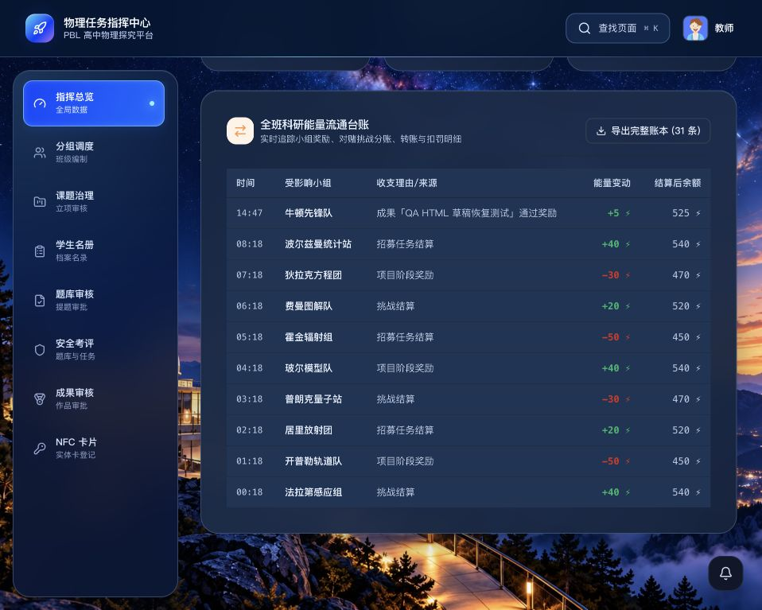
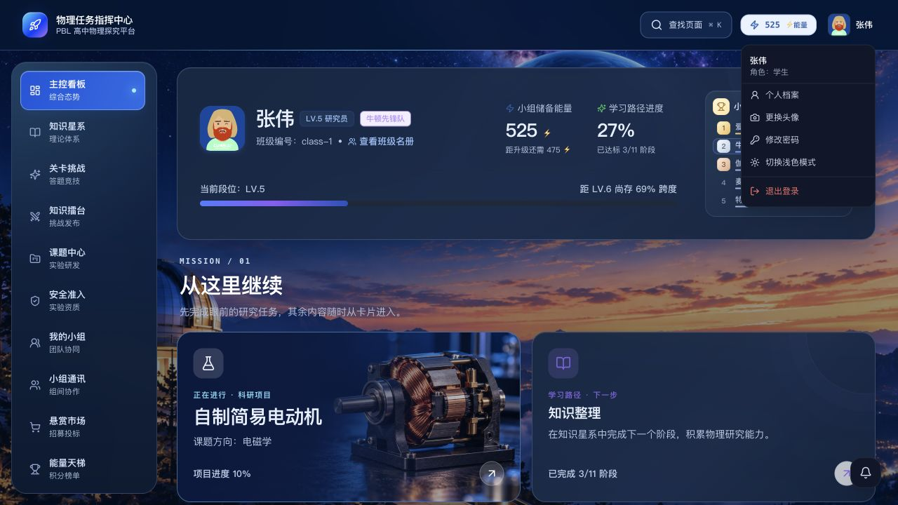
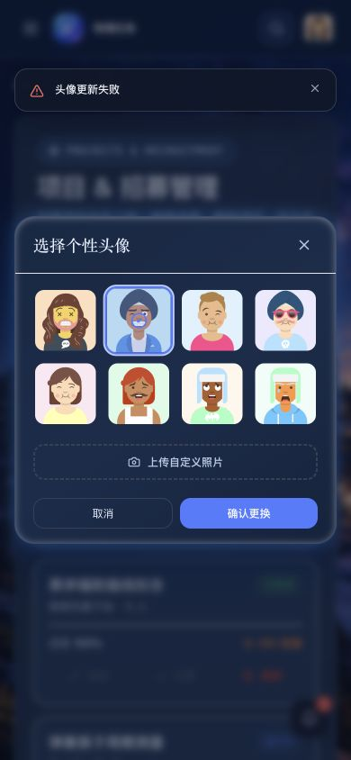
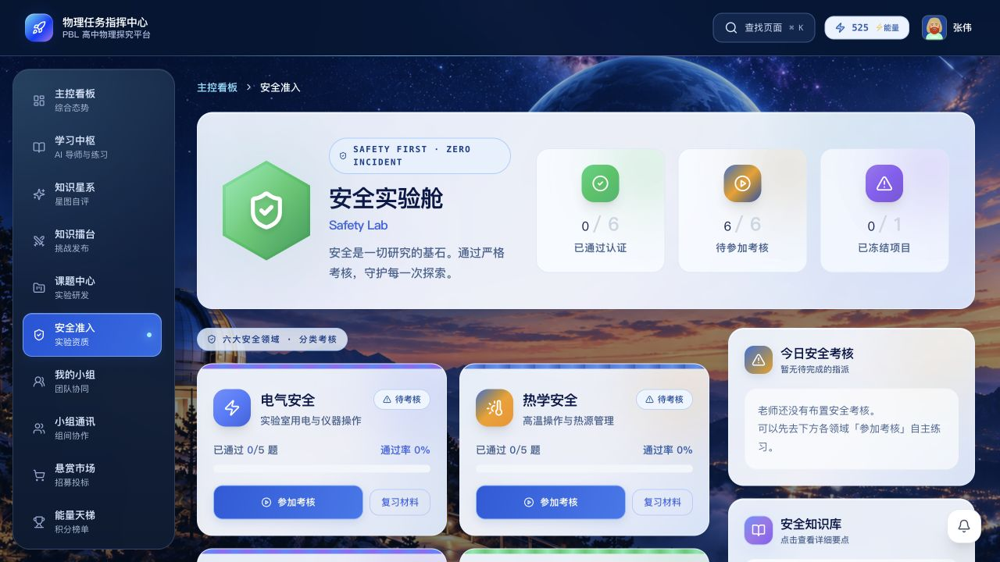
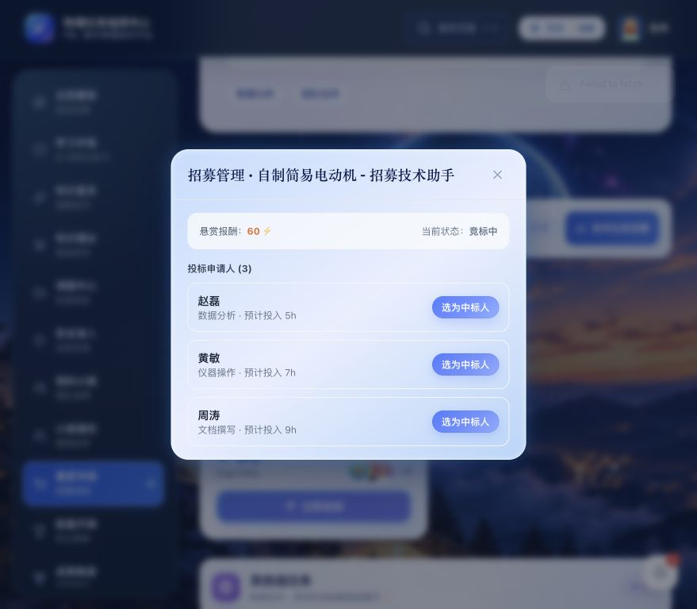
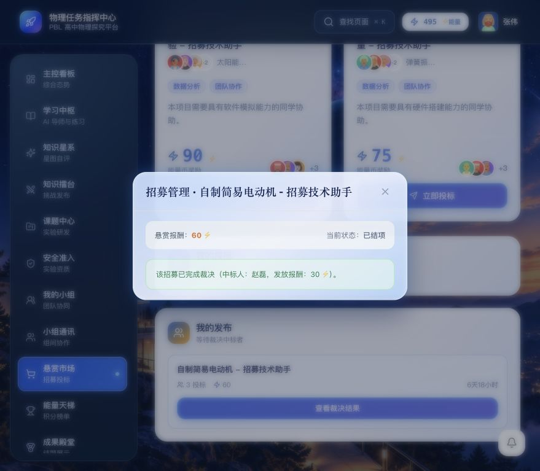
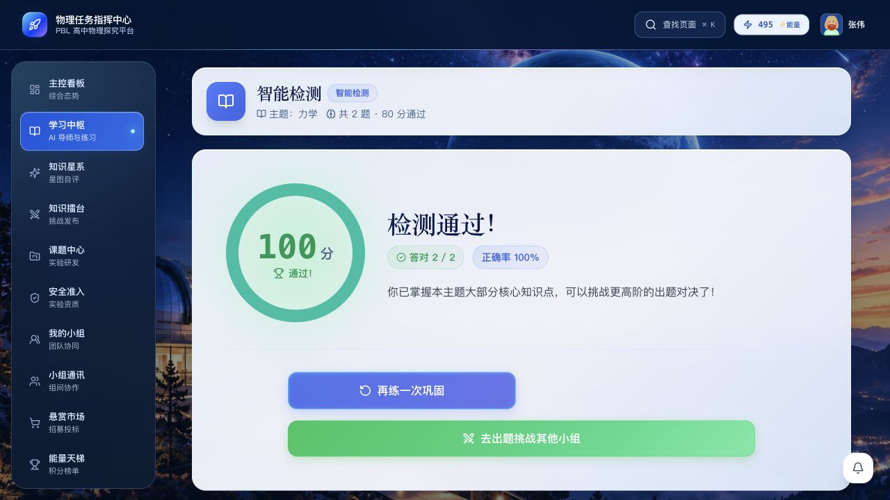

# 代码审视修复与验证记录（2026-10-25）

本次针对用户修改后的工作区，修复已确认的三个问题。保留其他工作区修改；下方追加本轮完善与提交前的验证结果，未推送或部署。本记录仅代表本地验证，不代表云端验收。

## 修复内容

1. `refreshDomainsFromApi` 为小组和流水分别增加请求版本号。旧请求晚返回时不再覆盖新数据，两个业务域独立刷新；保留会话重置后的失效保护。
2. 在现有 workspace/student 样式之后加载深色配色，补齐卡片、标题、正文、表格、输入框、标签及弹窗的前景和背景。
3. 即时提示通过 React portal 挂载到 body，避开页面 isolation/overflow 的限制；层级设为 1000，手机左右各留 16px。

## 自动验证

| 命令 | 结果 |
| --- | --- |
| `node scripts/test-dashboard-refresh.cjs` | 通过：乱序响应、业务域独立刷新、会话重置、请求失败保留已有数据 |
| `npm run check` | 通过 |
| `npm run lint` | 通过 |
| `node scripts/test-ui-reliability.cjs` | 通过 |
| `node scripts/test-showcase-upload.cjs` | 通过，5 个异步场景 |
| `npm run test:core` | 通过 |
| `npm run build` | 通过；仍有 bootstrap/sessionCleanup 同时静态与动态导入的构建提示 |
| `cd backend && .venv/bin/python -m pytest tests/ -q` | 297 passed，5.61s；698 条依赖及生命周期 API 弃用警告 |
| `git diff --check` | 通过 |

轮询测试先在修复前复现失败（新余额 600 被旧响应覆盖为 500），再在修复后通过。测试读取并转译实际 bootstrap 模块，以可控的请求完成顺序验证状态写入。

## 浏览器验证

环境：前端 `http://127.0.0.1:18100`，后端 `127.0.0.1:18101`，独立测试数据库 `/tmp/physics-ui-20261025.db`。使用合成师生账号，没有操作云端正式数据。

| 场景 | 观察结果 |
| --- | --- |
| 教师深色总览与表格 | 标题实测颜色为 `rgb(230,239,255)`，流水表格及卡片前景可辨认 |
| 学生深色主控看板 | 标题实测颜色为 `rgb(230,239,255)`，查看卡片与正文；学生测试页没有捕获到 error/warn 日志 |
| 桌面弹窗中的请求失败 | 在头像弹窗中临时阻断网络，确认“头像更新失败”浮于遮罩和弹窗上方 |
| 手机 390×844 下同一失败场景 | 提示完整显示；容器父元素为 BODY，z-index 为 1000，边界 x=16 到 x=374 |
| 恢复浅色模式 | 学生标题恢复为 `rgb(7,23,73)`；已恢复默认视口，并清除网络阻断 |

网络失败场景的错误日志是主动故障注入的预期结果。期间教师合成账号头像曾成功改为预设头像 1；其余失败请求未保存更改。未上传新文件。

本次手机验证覆盖提示与弹窗；学生看板截图为桌面验证，不宣称全站移动端或全部深色页面已逐页验收。

## 截图

教师深色界面：

学生深色界面：

手机弹窗与错误提示：

## 学生界面再次审视后的完善

本轮同时保留用户对学生看板、导航、项目、小组、安全准入和招募界面的调整，修复以下四项可复现的功能问题：

1. 测验逐题保存串行完成后才判分，避免整份 JSON 答卷被并发更新覆盖；保存失败即停止交卷。
2. 挑战交卷采用服务端返回的逐题判定、正确答案和薄弱知识点，学生端不再对已隐藏的答案自行判分。解析仅出现在本人交卷响应，不写入公开列表。
3. 选定中标人与裁决等待服务器确认后才更新状态、显示成功；失败保留弹窗，可重试。实际报酬采用服务器值，结算成功后余额刷新失败单独提示，不重复结算。小组通讯中的裁决入口同步修复。
4. 安全准入的冻结数按实际项目 `status=frozen` 统计，不再由安全认证数推算。

新增 `scripts/test-student-review-fixes.cjs` 覆盖答卷顺序/失败停止、隐藏答案下的挑战解析、招募请求确认/失败回退、弹窗反馈和冻结统计；后端新增混合题型挑战解析与答案隔离测试。新增后端测试在实现前因缺少 `questionResults` 失败，实现后通过。

### 本轮自动验证

- `node scripts/test-student-review-fixes.cjs`：通过。
- `npm run check`、`npm run lint`、`npm run build`：通过，构建仍有既有静态/动态导入提示。
- `node scripts/test-dashboard-refresh.cjs`、`node scripts/test-ui-reliability.cjs`、`node scripts/test-showcase-upload.cjs`、`npm run test:core`：通过。
- 后端 `.venv/bin/python -m pytest tests/ -q`：**298 passed，11.36s**；702 条既有依赖/生命周期 API 弃用警告。
- `git diff --check`：通过。

### 本轮浏览器验证（同一本地隔离环境）

- 学生安全准入页：未冻结的项目显示 **0/1 已冻结项目**，与数据库项目状态一致。
- 选定中标人：临时阻断网络后显示错误，弹窗保持竞标中；恢复网络重试后显示已选定赵磊，状态为协作进行中。
- 部分裁决：阻断网络后保持协作进行中；恢复后成功结项，结果显示实际发放 **30 能量币**，本组余额从 525 刷新到 495。
- 故障注入产生的 `Failed to fetch` 属于预期；测试后已解除网络阻断。操作仅使用合成账号和本地独立数据库。

- 测验浏览器回归：使用合成的单选与判断两题，选择 `0` 与 `false` 后交卷，结果为 **2/2、100 分**；独立测验标签页未捕获到 error/warn 日志。测试题目仅写入本地隔离数据库。

本记录覆盖上述明确列出的路径；不代表全站、全部手机尺寸或云端逐项验收。当前工作区代码和记录一同提交，本地工具产物 `.claude-engineer/` 不纳入提交。
