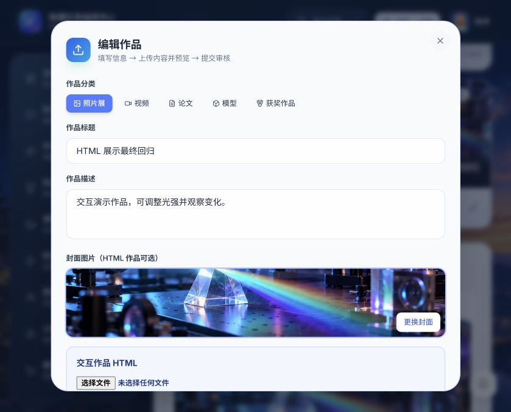

# 作品展示上传与编辑优化（2026-10-23）

## 范围

按最新要求移除本次新增的游客入口、游客页面和匿名公开接口。成果展示继续要求登录。

原有光学与电机 Demo 是内置 React/SVG 组件，由 demoKind 选择，并非上传的 HTML。本次新增单文件 HTML 作品能力。

## 使用流程

1. 登录后进入成果殿堂，点击“上传作品”。
2. 填写标题、描述、分类；选择 HTML 文件，可选上传封面。
3. 在表单内操作预览，确认后提交审核。
4. 教师在成果审核中打开 HTML 预览，再通过或驳回。
5. 本组成员可以修改说明、替换封面及 HTML，或移除 HTML；学生修改后重新进入待审核。

支持自包含的 .html/.htm 文件，UTF-8 总大小不超过 1,000,000 字节。CSS、JavaScript 和图片需内嵌；不支持 ZIP、多文件项目、外部脚本/CDN 或网络接口。HTML 在 sandbox iframe 中运行，不授予同源、弹窗、表单和顶层导航权限；CSP 限制外部资源及网络接口。自编 HTML 的内部响应式布局由作品自身决定。

## 多模态成果展示全品类升级

1. **多模态协议编解码 (`src/lib/showcaseMedia.ts`)**：
   - 在保持数据库 `showcase_items.html_content` 单列结构（兼容旧库幂等迁移与 1MB UTF-8 限制）的前提下，支持 4 类多模态载荷：
     - `<!--VIDEO_SRC-->`：视频地址或本地小视频 DataURL，配合 `captureVideoFrame` 自动提取视频首帧生成高清缩略封面。
     - `<!--PAPER_MD-->`：Markdown 学术研究报告/论文，内置标准学术论文模板。
     - `<!--MODEL_3D:obj|stl|preset-->`：Wavefront `.obj`、ASCII `.stl` 三维网格及 3 款内置三维实验装置模型（托卡马克磁约束环、开普勒折射望远镜、双振子耦合支架）。
     - 标准单文件 HTML 交互仿真（内置简谐振子阻尼相空间模板）。
2. **专用交互渲染器组件群 (`src/components/showcase/`)**：
   - `VideoShowcasePlayer.tsx`：支持 0.5x~2.0x 倍速切换、循环播放、异常兜底。
   - `PaperArticleReader.tsx`：基于 `react-markdown` 渲染章节排版、自动提取 `#/##/###` 目录大纲跳转、字数统计与 `.md` 导出。
   - `Model3DViewer.tsx`：Canvas 3D 透视投影检视器，支持拖拽 360° 旋转、滚轮缩放、线框/实体着色切换、自动旋转与视角复位。
   - `HtmlDemo.tsx`：新增「重置运行」「查看源码」「全屏演示」工具栏。
   - `ShowcaseContentRenderer.tsx`：统一多模态分发渲染组件，同时服务于学生端「成果展览馆」与教师端「成果审批」。
3. **业务闭环增强**：
   - 点赞持久化：对接 `POST /api/showcase/{id}/love`，支持全员持久化点赞/取消点赞与 `lovedBy` 状态同步。
   - 课题绑定：上传与编辑作品支持绑定/解绑本组研究课题（`projectId`），后端严格校验课题归属小组。
   - 获奖作品聚合：`award` 分类视图自动聚合显式获奖作品与教师审核授予能量币（`awardedCoins > 0`）的嘉奖作品。
- 上传/编辑弹窗通过 portal 放到页面顶层，避免页面动画容器影响定位。
- 新建表单清空上次编辑状态；标题、说明和上传入口补充可访问名称。
- 在线提交等待服务器确认，保存中禁用提交；失败保留表单并显示错误。
- HTML 超限/格式错误就地提示，保留原有有效 HTML。
- 优秀作品榜只收录审核通过的作品。
- 数据库启动迁移增加 html_content 字段，旧作品默认空值。

## 验证记录

环境：本机独立 SQLite 测试库，前端 127.0.0.1:18100，后端 127.0.0.1:18101。使用合成 HTML/PNG；未写入正式数据库。

| 检查 | 结果 |
| --- | --- |
| 本次提交的独立源码快照 pytest | 279 passed；604 条警告 |
| 当前完整工作区 pytest（含其他未提交工作） | 291 passed；639 条警告 |
| 本次提交的独立源码快照前端生产构建 | 通过 |
| 本次提交的独立源码快照 ESLint | 通过 |
| 登录页移除游客入口 | 浏览器确认 |
| 手机编辑弹窗 | 390px 视口、页面宽 390px、弹窗宽 358px，无横向溢出 |
| 保存后再次打开编辑 | 新描述持久化、HTML 预览保留 |
| 匿名读取/上传/点赞 | 后端测试拒绝；匿名公开接口返回 404 |
| HTML 创建、读取与替换 | 后端测试及浏览器通过 |
| HTML 预览 JavaScript 按钮 | 点击后光强由初始值更新为 1 级 |
| HTML 访问父页面 | 合成测试捕获隔离异常，显示“父页面访问已隔离” |
| 教师 HTML 预览及审核 | 浏览器通过，奖励设为 0 |
| 学生编辑后重新审核 | 浏览器及接口测试通过 |
| 其他小组修改作品 | 后端测试返回 403 |
| PNG 封面替换 | 浏览器上传并保存通过 |
| 超出 1 MB 文件 | 浏览器显示就地错误；后端英文/中文 UTF-8 大小校验通过 |
| 移除 HTML | 后端测试空内容保存通过 |
| 保存失败 | 停止测试后端，浏览器确认表单保留且显示错误 |
| 旧数据库迁移 | 保留已有作品、补空 HTML 字段，重复迁移测试通过 |
| 论文/报告在线编辑与章节大纲/表格阅读器 | 浏览器 E2E 通过（531 字、章节大纲、GFM 表格渲染、导出 `.md`） |
| 3D 模型（托卡马克/望远镜/双振子 + `.obj`/`.stl`） | 浏览器 E2E 通过（392 顶点 · 784 面、360° 拖拽、线框/实体切换） |
| 实验视频播放器与倍速/循环控制 | 浏览器 E2E 通过（0.5x~2x 倍速、循环切换、首帧自动截图） |
| HTML 交互仿真模板与源码/重置/全屏工具栏 | 浏览器 E2E 通过 |
| 点赞持久化（刷新浏览器后恢复） | 浏览器 E2E 通过（`0 人点赞 -> 1 人点赞`，刷新后保持 `1 人点赞`） |
| 教师端多模态内联预览与审批发币（+20 ⚡） | 浏览器 E2E 通过 |
| 成果展览馆「获奖作品」Tab 自动聚合获币作品 | 浏览器 E2E 通过 |
| 全流程浏览器 `pageerror` 监控 | 0 未捕获异常 |

服务重启后开发环境临时签名使旧登录失效，需要重新登录；这与网络失败时原页面保留表单是不同场景。测试中原光学 Demo 参数变化正常。游客流程的早期测试不属于最终交付范围。

本记录仅代表本地验证，未部署本次变更到云端。

界面截图：

